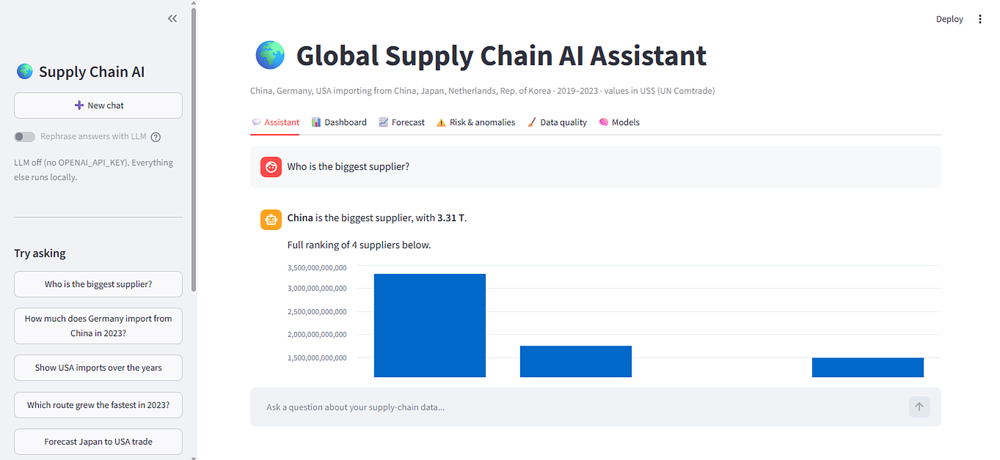
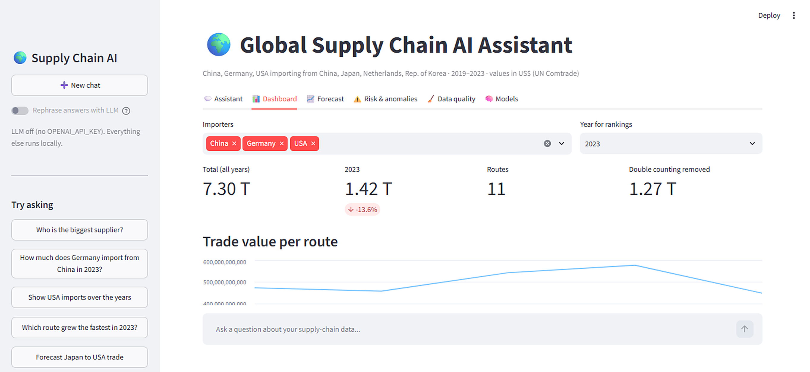
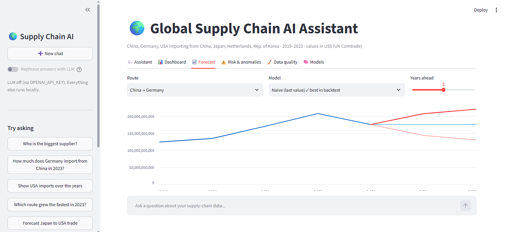
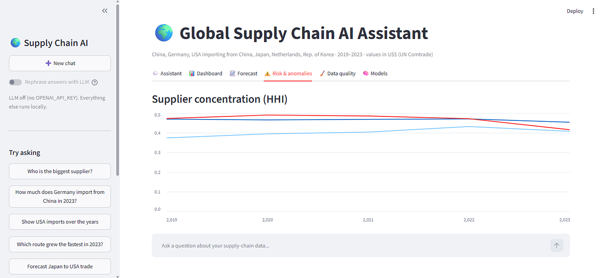
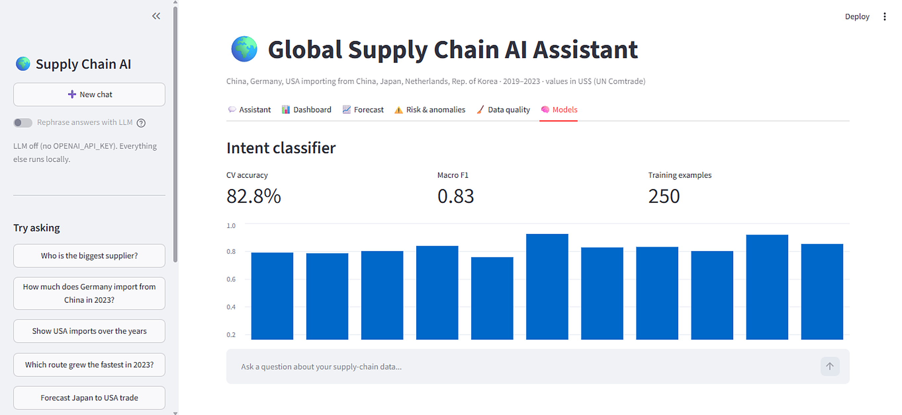
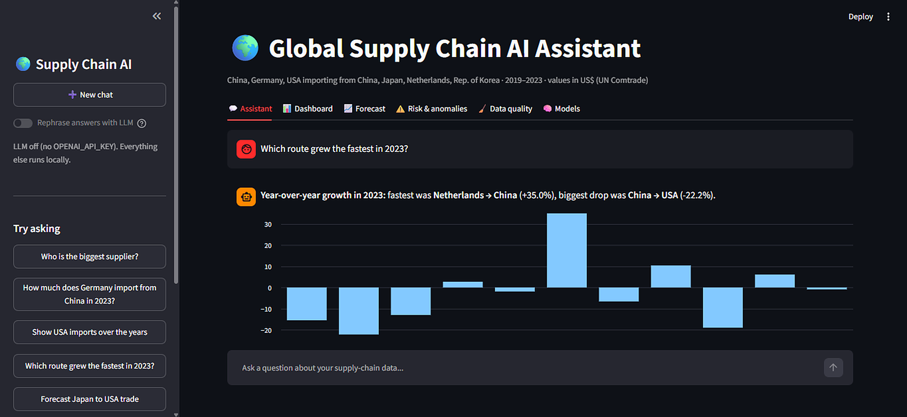

# Global Supply Chain AI Assistant

**82.8% intent accuracy · 5 forecasting models backtested · anomaly detection · Streamlit app + FastAPI · 45 automated tests**

Ask questions about global trade data in plain English, and get answers, charts, forecasts and risk flags.

A machine learning classifier works out what kind of question you are asking, and the answer is then calculated
directly from the data, so the model never makes up a number. The app also forecasts each trade route, flags
unusual years and measures how much each importer depends on a single supplier.

One detail in the data needed care: for Germany, the CSV has both country totals and product-level rows,
so a simple sum would count Germany twice.

The data comes from my [Global Supply Chain Dashboard](https://github.com/ammu-analytics/global-supply-chain-dashboard)
project (UN Comtrade, 2019–2023, DOI [10.5281/zenodo.21299744](https://doi.org/10.5281/zenodo.21299744)).
I started both projects because I wanted to understand how events like COVID-19 disrupted global supply chains.

---

## Screenshots

| Assistant | Dashboard |
|---|---|
|  |  |
| **Forecast** | **Risk & anomalies** |
|  |  |
| **Models** | **Dark theme** |
|  |  |

## What it does

| Feature | How |
|---|---|
| **Understands questions** | TF-IDF + logistic regression intent classifier (11 question types), plus rules that find countries (even with small spelling mistakes), years and "top N" |
| **Answers with real numbers** | pandas on a cleaned route table. The model only picks *what* to calculate, never the number itself |
| **Forecasts 2024–2026** | 5 models compared with a rolling backtest. The best one is used, and the forecast range comes from the backtest errors |
| **Finds unusual years** | Isolation Forest on growth, distance from trend, and difference from the other routes that year |
| **Supply chain risk** | Herfindahl index (HHI) of supplier concentration per importer, and product-line concentration for Germany |
| **Data quality report** | Finds and removes the double-counted rows, and shows before/after totals |
| **Web app** | Streamlit, with tabs for Assistant, Dashboard, Forecast, Risk, Data quality and Models |
| **REST API** | FastAPI (`/ask`, `/forecast`, `/anomalies`, `/routes`, `/quality`) with auto-generated docs |
| **Tests** | 45 automated tests (pytest) covering data cleaning, the models, the assistant and the API |
| **Optional LLM** | If `OPENAI_API_KEY` is set, an LLM can reword answers. It gets the computed answer and is told not to add numbers |

## Results

Run `python train.py` to reproduce these.

**Intent classifier:** 250 labelled questions, 11 intents, 5-fold cross-validation

| | Accuracy |
|---|---|
| Keyword-rule baseline (`if "biggest" in question`) | 16.4% |
| TF-IDF + logistic regression | **82.8%** (macro F1 0.83) |

(The baseline is a set of simple if/else keyword rules, like most first chatbots use. It only covers a few
question types and breaks as soon as the wording changes, which is why I trained a classifier instead.)

**Forecasting:** predict 2022 and 2023 from earlier years, for all 11 routes

| Model | MAPE |
|---|---|
| Naive (next year = this year) | **10.8%** |
| Blend of naive + trend + pooled AR | 13.2% |
| Log-linear trend | 13.6% |
| Average growth (CAGR) | 14.1% |
| Pooled Ridge AR(1) on growth | 18.8% |

The simplest model won. With only 5 yearly points per route, there isn't enough history for the trend and
regression models to beat "same as last year", and 2020–2023 had big shocks (COVID, the 2022 peak, the 2023 drop).
I kept all models in the app so you can compare them, but by default it uses whichever one scored best in the backtest.

**Anomalies flagged:** Netherlands → China 2023 (+35%), China → USA 2023 (−22%), Rep. of Korea → China 2023 (−19%),
China → Germany 2023 (−15.5%) and 2022 (+21.8%), Japan → USA 2020 (−16.7%).

## Totals and product-level rows

For Germany 2020–2023, the CSV has one **total** row per supplier and year, **plus** 2,483 product-line rows that
add up to exactly that total. If you simply sum the whole column, Germany is counted twice:

| | Value (US$) |
|---|---|
| Simple sum of the column | 8.57 T |
| Cleaned total | 7.30 T |
| Double counted | 1.27 T |

`supplychain/data.py` checks every importer–supplier–year group. If the other rows add up to the biggest row
(within 1%), the biggest row is kept as the total and the others are kept separately as product lines.

## Project structure

```
global-supply-chain-ai-assistant/
├── app.py                 Streamlit web app
├── api.py                 FastAPI REST API
├── train.py               trains + evaluates everything, writes models/report.json
├── data/
│   ├── global_supply_chain.csv
│   └── intents.csv        labelled questions for the classifier
├── supplychain/
│   ├── data.py            loading + cleaning
│   ├── analytics.py       totals, rankings, growth, HHI
│   ├── nlp.py             entity extraction + intent classifier
│   ├── forecast.py        models + rolling backtest
│   ├── anomaly.py         Isolation Forest
│   ├── assistant.py       question -> answer
│   └── llm.py             optional OpenAI rewording
├── images/                screenshots used in this README
├── models/                saved model + metrics (created by train.py)
└── tests/                 pytest
```

## How to run

```bash
python -m venv .venv
source .venv/bin/activate        # Windows: .venv\Scripts\activate
pip install -r requirements.txt

python train.py                  # trains models, prints the results above
streamlit run app.py             # web app at http://localhost:8501
uvicorn api:app --reload         # API, docs at http://127.0.0.1:8000/docs
pytest                           # run the tests
```

If you skip `train.py`, the app trains the classifier automatically the first time it starts.

Optional LLM rewording:

```bash
export OPENAI_API_KEY=sk-...     # Windows: set OPENAI_API_KEY=sk-...
```

### Example API call

```bash
curl -X POST http://127.0.0.1:8000/ask \
  -H "Content-Type: application/json" \
  -d '{"question": "How much does Germany import from China in 2023?"}'
```

## Example questions

- Who is the biggest supplier?
- Top 3 suppliers to Germany in 2021
- How much did China import from Korea in 2022?
- Show USA imports over the years
- Which route dropped the most in 2023?
- Forecast Japan to USA trade for 2025
- How dependent is Germany on China?
- Any anomalies in the data?
- Was anything double counted?

## Limitations

- Only 3 importers, 4 suppliers and 5 years, so forecasts are rough. The app shows a range, not just one number.
- Supplier shares are shares *within this dataset*, not of each country's total imports.
- The Germany product lines have no product codes, so the app can't say which products they are. Adding HS codes would
  be the next step.
- The intent classifier is trained on 250 example questions. More real user questions would make it better.

## Tech

Python · pandas · scikit-learn · Streamlit · FastAPI · pytest · (optional) OpenAI API

## License

MIT
